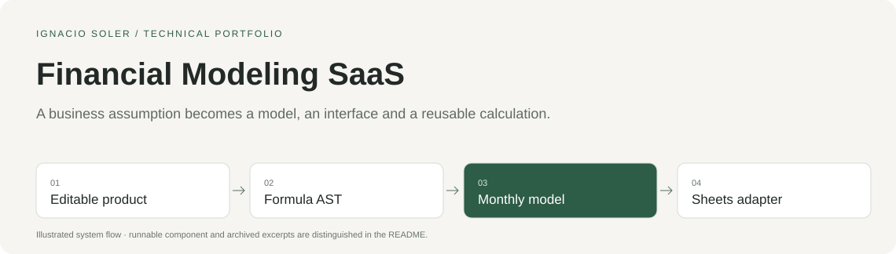

# Producto de modelos financieros

**Un producto de modelización financiera con hipótesis editables y asistencia de IA**

*Un caso de Chals AI — construido por Ignacio Soler.*

Construí un producto de planificación financiera para editar hipótesis de negocio, calcular proyecciones, comparar presupuestos y explorar escenarios mediante una interfaz y un chat integrados. Después adapté las capacidades de modelización a un panel lateral de Google Sheets.

Construí este proyecto yo solo, de principio a fin, utilizando herramientas de IA para toda la programación. Me encargué de la definición del producto, las decisiones técnicas, la implementación, la integración y la validación.

[Ver el frontend](#ver-el-frontend) · [Explorar la implementación](#explorar-la-implementación) · [Probar el componente](#probar-el-componente) · [English](../README.md)

## Qué construí

- Una interfaz en React y TypeScript con variables de negocio editables, tablas presupuestarias y paneles.
- Un parser de fórmulas y un motor de cálculo en backend para proyecciones mensuales y dependencias.
- Una adaptación a Google Sheets para utilizar las capacidades de modelización en hojas de cálculo.

**Estado:** Construido entre 2025 y julio de 2026 como una generación anterior de Chals AI. El frontend propio no captó clientes.

## Ver el frontend

Tres recorridos guiados del frontend muestran análisis de escenarios, modelización financiera y creación de agentes personalizados. Utilizan datos sintéticos e interacciones con guion de una generación anterior del producto.

### Análisis y escenarios · 57s

https://github.com/user-attachments/assets/69282a3f-8c7d-4804-9ecb-95bc54f11465

[Abrir la demo a pantalla completa](https://chalsai.com/demo.html?script=analysis-whatif&utm_source=github&utm_medium=portfolio&utm_campaign=financial-modeling-saas) · [Descargar MP4](demos/analysis-whatif.mp4)

### Modelización y presupuesto · 63s

https://github.com/user-attachments/assets/2d61e940-98b4-4818-83e8-7e2fbc52519e

[Abrir la demo a pantalla completa](https://chalsai.com/demo.html?script=modeling-budget&utm_source=github&utm_medium=portfolio&utm_campaign=financial-modeling-saas) · [Descargar MP4](demos/modeling-budget.mp4)


### Creación de agentes personalizados · 85s

https://github.com/user-attachments/assets/418023e3-7c39-4082-ba8b-140ba44dab4a

[Abrir la demo a pantalla completa](https://chalsai.com/demo.html?script=custom-agents&utm_source=github&utm_medium=portfolio&utm_campaign=financial-modeling-saas) · [Descargar MP4](demos/custom-agents.mp4)

[Procedencia de los vídeos](demos/manifest.json).



## Explorar la implementación

El componente ejecutable contiene el evaluador mensual original de fórmulas representadas como AST. Los extractos de código documentan el trabajo más amplio: componentes React, parser de fórmulas, compilación de dependencias y adaptador de Google Sheets.

| Recurso | Qué puedes consultar |
|---|---|
| [timeseries_engine.py](../source/timeseries_engine.py) | Componente original ejecutable |
| [demo.py](../demo.py) | Datos sintéticos y 3 comportamientos comprobados |
| [Arquitectura](architecture.md) | Sistema completo y alcance de la muestra |
| [Decisiones de diseño](decisions.md) | Decisiones y referencias al código |
| [Recorrido del código](code-tour.md) | 8 extractos seleccionados de la implementación |
| [Procedencia](../provenance.json) | Rutas originales, commits, hashes y modificaciones documentadas |

<details>
<summary>Ver los extractos seleccionados</summary>

- [E06 Prototipo financiero React con datos sintéticos](../evidence/E06.md)
- [E07 Registro y autenticación de usuario en frontend](../evidence/E07.md)
- [E08 Parser TypeScript de fórmulas a AST](../evidence/E08.md)
- [E09 Compilación SQL, dependencias y componentes fuertemente conexas](../evidence/E09.md)
- [E10 Grid presupuestario, borradores y protección frente a previews antiguas](../evidence/E10.md)
- [E19 Contrato del add-on, identidad y adaptador de Sheets](../evidence/E19.md)
- [E20 Apps Script, sesión, readback y bridge de hoja/dataset](../evidence/E20.md)
- [E21 BigQuery IAM por workspace y Connected Sheets](../evidence/E21.md)

</details>

**Tecnologías del proyecto:** React · TypeScript · Python · AST / SQL · Google Apps Script.

Este caso público incluye código original seleccionado y una muestra ejecutable aislada con datos sintéticos. Las integraciones de producción y los datos de clientes se mantienen privados. Las rutas originales, commits, hashes y modificaciones se registran en [provenance.json](../provenance.json).

## Probar el componente

Ejecuta localmente el evaluador mensual original de fórmulas representadas como AST con datos sintéticos. Requiere **Python 3.10 o posterior**, sin instalar dependencias ni conectar una cuenta. Ejecuta estos comandos desde la terminal:

```sh
git clone https://github.com/nasoler123/financial-modeling-saas.git
cd financial-modeling-saas
python3 -I demo.py
python3 verify.py
```

Resultados esperados:

- Un crecimiento mensual del 10 % desde 100 produce 110, 121, 133,10 y 146,41.
- Fijar febrero en 150 produce 110, 150, 165 y 181,50.
- Un crecimiento cero mantiene la serie en 100.

La muestra funciona sin conexión y rechaza conexiones de red y subprocesos externos. `verify.py` comprueba enlaces locales, igualdad de instrucciones, hash del código, patrones de credenciales y coincidencia con los resultados registrados de las comprobaciones del componente. [Resultados registrados](../verification.json).

## Más proyectos de Chals AI

Estos proyectos recogen mi trabajo en automatización de negocio, software financiero, agentes de IA e infraestructura de datos.

[Data Platform and MCP](https://github.com/nasoler123/data-platform-mcp) · [AI Agent Harness](https://github.com/nasoler123/ai-agent-harness) · [Invoice Automation](https://github.com/nasoler123/invoice-automation)

[Ignacio Soler](https://github.com/nasoler123) · [LinkedIn](https://www.linkedin.com/in/ignacio-soler-esteban/)
