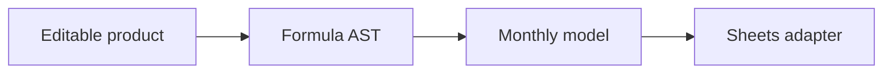

# Architecture

[Project](../README.md) · [Design decisions](decisions.md) · [Code tour](code-tour.md)

## System built

I built a financial modeling product with editable drivers, budget grids and dashboards, a formula parser and backend execution, and then adapted the same capabilities to a Google Sheets sidebar.

## Runnable boundary

This repository runs the original monthly AST evaluator. React components, dependency compilation and the Sheets adapter are selected excerpts. It does not boot the original SaaS frontend or connect a Google account.

The local route is `synthetic fixture → original component → checked result`. [Read the component](../source/timeseries_engine.py) and [run the fixture](../demo.py). The network is blocked before the component is imported.

## External dependencies of the full system

React · TypeScript · Python · AST / SQL · driver dependencies · Google Apps Script. The original product connects these components through shared runtime and account context. This repository preserves selected examples and a bounded local demonstration.
